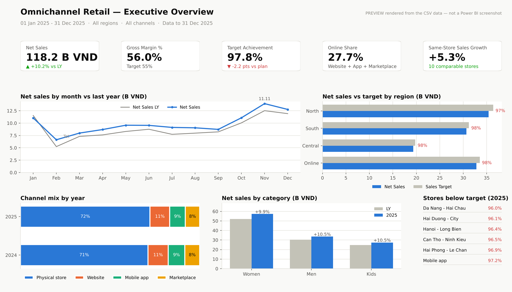
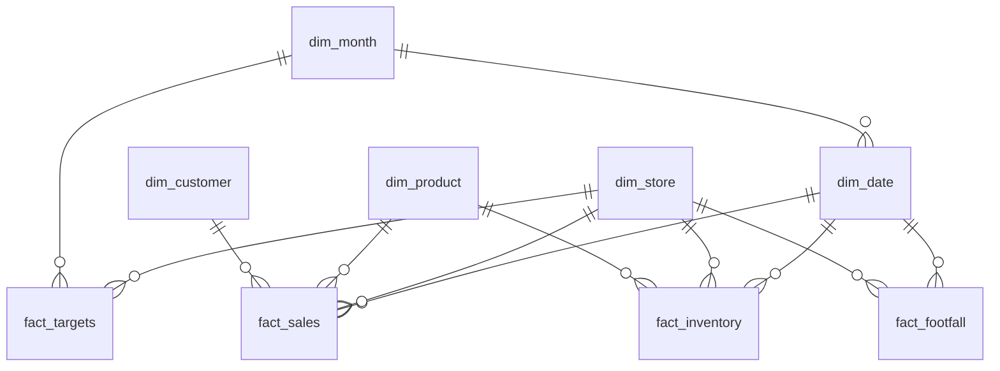

# Omnichannel Retail Dashboard (Power BI)

[](model/)
[](model/measures.dax)
[](data/generate_data.py)
[](LICENSE)

An end-to-end Power BI project for a fashion retailer selling through 12 physical stores and three
online channels: a documented **star-schema data model**, a **library of 55 DAX measures** (time
intelligence, same-store growth, targets, inventory snapshots, conversion, loyalty), **Power Query
scripts**, a **report theme**, a page-by-page **report specification**, and the performance
reasoning behind each modelling decision.

It recreates the BI work I did for an omnichannel fashion chain, rebuilt on synthetic data so it
can be shared. The modelling patterns, measure definitions and performance notes are the ones I
use in production.



*Preview of the Executive Overview page rendered from the data with Python (see
[`scripts/make_preview.py`](scripts/make_preview.py)). Power BI screenshots are in
[`report/screenshots/`](report/screenshots/) once the `.pbix` is published.*

## What the dashboard answers

| Page | Audience | Question | Finding on this dataset |
|---|---|---|---|
| Executive Overview | Leadership | Are we on plan, where is the gap? | 2025 net sales **118.2B VND, +10.2% YoY**, but **97.8% of target** with 14/15 locations below plan — targets (LY + 8%) outran comparable-store growth (+5.3%). |
| Channel Performance | E-com & retail ops | Which channels grow, which depend on discounts? | Online is **27.7%** of sales and the only channel trading through Tet; marketplace carries the highest discount rate. |
| Store Performance | Regional managers | Which stores need attention? | Outlets have the lowest **sales per sqm (16–21M VND)**; the flagship stores lead at 31–33M. Conversion averages **21.4%**. |
| Product & Inventory | Merchandising | What to mark down, what to re-order? | **FW stock at 14 weeks of cover** at end-April vs 6 weeks for SS — a seasonal overhang worth a March markdown plan. |
| Customers & Loyalty | CRM | Is identification working? | 60.6% of sales are tied to an identified customer (100% online, ~45% in store). |

Details, visuals and measures per page: [`report/report_spec.md`](report/report_spec.md).

## Data model



4 dimensions · 4 facts · 548k sales lines · 85k inventory snapshot rows · 2 years daily.
Single-direction relationships only; semi-additive inventory handled in DAX, not in the model.
Full column list, grain and the reasoning behind every decision: [`model/data_model.md`](model/data_model.md).

## DAX highlights

From [`model/measures.dax`](model/measures.dax) — 56 measures in 9 display folders. A few worth reading:

```dax
// Same-store growth: only stores open for the whole comparison period
Comparable Stores Net Sales =
CALCULATE (
    [Net Sales],
    FILTER (
        dim_store,
        dim_store[channel_type] = "Store"
            && dim_store[open_date] <= EDATE ( MIN ( dim_date[date] ), -12 )
    )
)

// Semi-additive inventory: take the last snapshot on or before the period end
Stock on Hand =
VAR MaxDate = MAX ( dim_date[date] )
VAR LastSnapshot =
    CALCULATE ( MAX ( fact_inventory[date_key] ), REMOVEFILTERS ( dim_date ), dim_date[date] <= MaxDate )
RETURN
    CALCULATE ( SUM ( fact_inventory[stock_on_hand] ), REMOVEFILTERS ( dim_date ), fact_inventory[date_key] = LastSnapshot )

// Weeks of cover at the period's average rate of sale
Weeks of Cover =
DIVIDE ( [Stock on Hand], DIVIDE ( [Store Units Sold], DIVIDE ( COUNTROWS ( dim_date ), 7 ) ) )
```

## Performance notes

The real migration this is based on (Tableau → Power BI, ~40× this data volume) went from 9–12 s
to under 2 s per visual. What moved the needle, in order: flattening a snowflaked product
hierarchy into one dimension, removing bi-directional relationships, replacing
`FILTER(ALL(fact))` patterns with dimension filters, pre-aggregating a sensor feed upstream,
turning Auto date/time off, and adding an aggregation table for the executive page.
Full write-up: [`model/data_model.md#performance-notes-from-the-real-project`](model/data_model.md#performance-notes-from-the-real-project).

## Build it yourself

1. `python data/generate_data.py` (optional — the CSVs are committed).
2. Follow [`docs/build_guide.md`](docs/build_guide.md): Power Query → relationships → measures → theme → pages. ~60–90 min.
3. Sanity checks are in the guide: `[Net Sales]` for 2025 must equal **118,171,760,000**; `[Target Achievement %]` must show **97.8%**.

## Repository layout

```
├── data/
│   ├── generate_data.py        # seeded synthetic data generator
│   └── star_schema/            # 8 CSVs (two facts gzipped)
├── model/
│   ├── data_model.md           # ERD, grain, modelling decisions, performance notes
│   ├── measures.dax            # 56 documented measures
│   └── power_query.pq          # M scripts to load every table
├── report/
│   ├── report_spec.md          # 5 pages: visuals, measures, findings
│   ├── theme.json              # report theme
│   ├── preview_executive_overview.png
│   └── screenshots/            # Power BI screenshots (added after publishing)
├── scripts/
│   └── make_preview.py         # renders the preview from the CSVs
└── docs/
    └── build_guide.md          # step-by-step rebuild in Power BI Desktop
```

## About

Built by **Ha Kieu Anh** — Data Analyst (Microsoft Certified: Data Analyst Associate), 5+ years in
retail, e-commerce and CRM analytics; now also working in AI training & evaluation.
[GitHub](https://github.com/Hakian14) · [LinkedIn](https://www.linkedin.com/in/kieu-anh-ha-6249a3172/) · hakieuanh662@gmail.com

License: [MIT](LICENSE)
