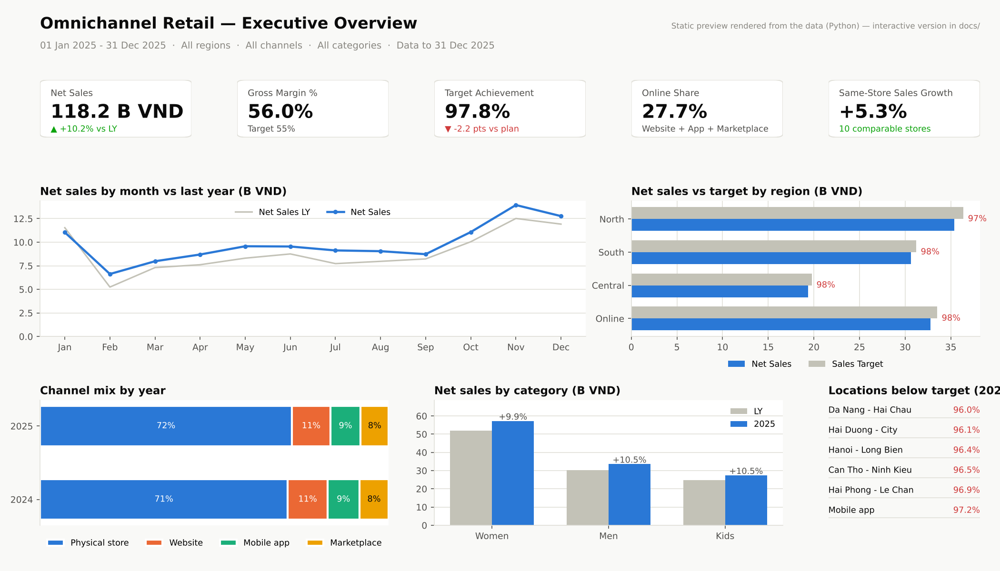
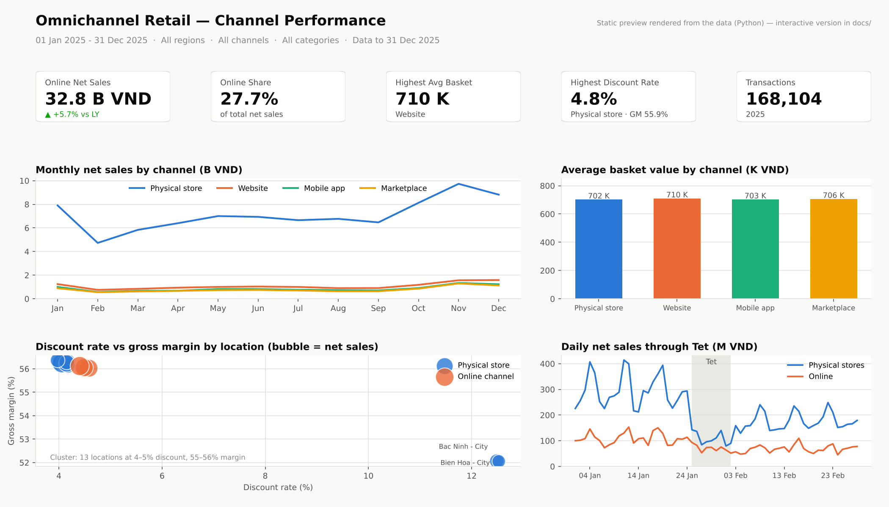
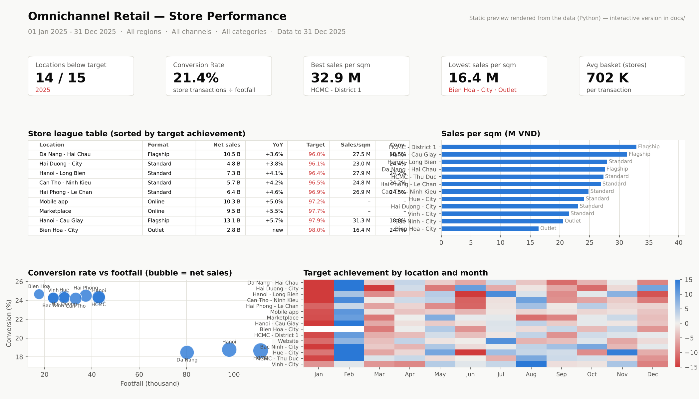
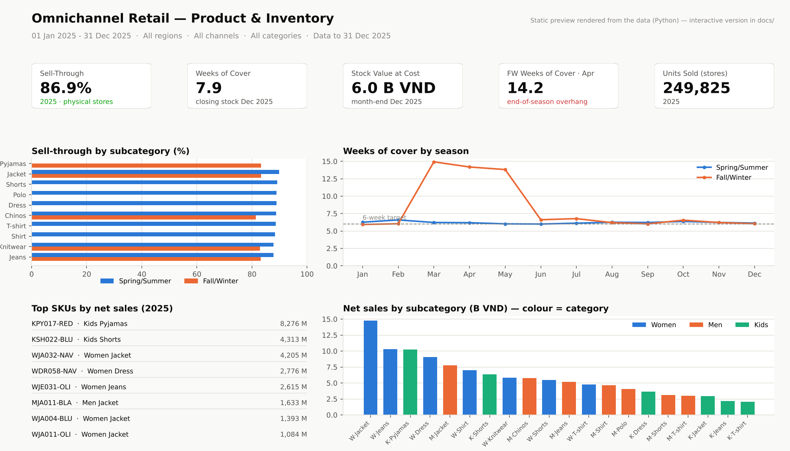
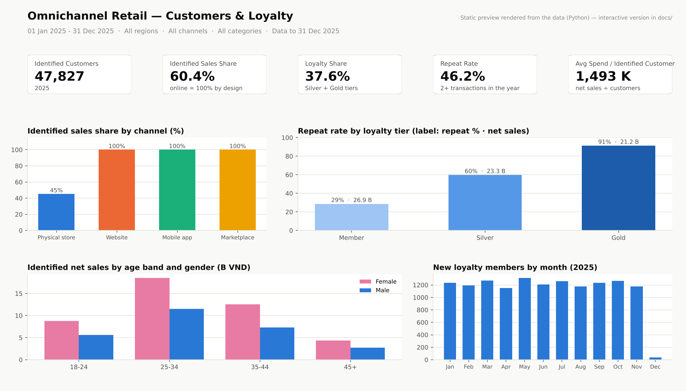
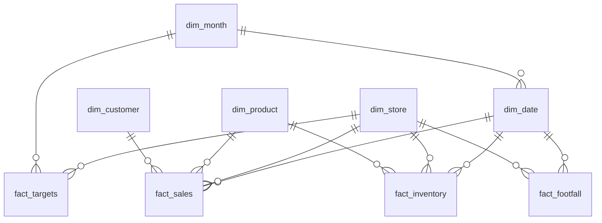

# Omnichannel Retail Dashboard — Power BI model + live web rendition

[](https://hakian14.github.io/omnichannel-retail-powerbi/)
[](model/)
[](model/measures.dax)
[](scripts/)
[](LICENSE)

A complete BI project for a fashion retailer selling through 12 physical stores and three online
channels, in two layers:

- **The Power BI design** — a documented star-schema semantic model, 54 DAX measures with display
  folders and format strings, Power Query scripts, a report theme, and a page-by-page report
  specification. This is the deliverable a BI team would build from.
- **A live, interactive rendition of the same five pages** — [`docs/index.html`](docs/index.html),
  served on GitHub Pages, so anyone can explore the dashboard without Power BI. Every KPI is
  computed in JavaScript with the same definitions as the DAX measures.

**→ Open the live dashboard: https://hakian14.github.io/omnichannel-retail-powerbi/**

It recreates the BI work I did for an omnichannel fashion chain, rebuilt on synthetic data so it
can be shared. The modelling patterns, measure definitions and performance notes are the ones I
use in production.

## The five pages

| Page | Audience | Question | Finding on this dataset |
|---|---|---|---|
| Executive Overview | Leadership | Are we on plan, where is the gap? | 2025 net sales **118.2B VND, +10.2% YoY**, but **97.8% of target** with 14/15 locations below plan — targets (LY + 8%) outran comparable-store growth (+5.3%). |
| Channel Performance | E-com & retail ops | Which channels grow, which depend on discounts? | Online is **27.7%** of sales and the only channel trading through Tet; the two outlets run 12% discounts against 4–5% elsewhere. |
| Store Performance | Regional managers | Which stores need attention? | Outlets have the lowest **sales per sqm (16–21M VND)**; flagships lead at 31–33M. Conversion averages **21.4%**. January targets miss everywhere because Tet moved — targets set on last year's month ignore the lunar calendar. |
| Product & Inventory | Merchandising | What to mark down, what to re-order? | **FW stock at 14 weeks of cover in March–May** vs 6 weeks for SS — a seasonal overhang worth a March markdown plan. |
| Customers & Loyalty | CRM | Is identification working? | 60.6% of sales tied to a known customer (100% online, ~45% in store). Repeat rate climbs from **29% (Member) to 91% (Gold)**. |



<details>
<summary><b>Previews of the other four pages</b> (static renders — the live dashboard is filterable)</summary>






</details>

Details, visuals and measures per page: [`report/report_spec.md`](report/report_spec.md).

## Data model



4 dimensions · 4 facts · 548k sales lines · 85k inventory snapshot rows · 90k loyalty members · 2 years daily.
Single-direction relationships only; semi-additive inventory handled in DAX, not in the model.
Full column list, grain and the reasoning behind every decision: [`model/data_model.md`](model/data_model.md).

## DAX highlights

From [`model/measures.dax`](model/measures.dax) — 54 measures in 9 display folders. A few worth reading:

```dax
// Same-store growth: only stores open for the whole comparison period
Comparable Stores Net Sales =
CALCULATE (
    [Net Sales],
    FILTER (
        dim_store,
        dim_store[channel_type] = "Store"
            && dim_store[open_date] <= EDATE ( MIN ( dim_date[date] ), -12 )
    )
)

// Semi-additive inventory: take the last snapshot on or before the period end
Stock on Hand =
VAR MaxDate = MAX ( dim_date[date] )
VAR LastSnapshot =
    CALCULATE ( MAX ( fact_inventory[date_key] ), REMOVEFILTERS ( dim_date ), dim_date[date] <= MaxDate )
RETURN
    CALCULATE ( SUM ( fact_inventory[stock_on_hand] ), REMOVEFILTERS ( dim_date ), fact_inventory[date_key] = LastSnapshot )

// Weeks of cover at the period's average rate of sale
Weeks of Cover =
DIVIDE ( [Stock on Hand], DIVIDE ( [Store Units Sold], DIVIDE ( COUNTROWS ( dim_date ), 7 ) ) )
```

The same three definitions in the web dashboard: `sameStoreGrowth()`, `lastSnapshot()` and
`weeksOfCover()` in [`docs/index.html`](docs/index.html). Keeping the two in step is the point —
the model is the specification, the web page is one rendering of it.

## The live dashboard

[`docs/index.html`](docs/index.html) is a single self-contained page (Plotly.js from CDN, no build
step) that loads pre-aggregated JSON from [`docs/data/`](docs/data/) — produced by
[`scripts/build_dashboard_data.py`](scripts/build_dashboard_data.py) from the star schema, 1.4 MB in
total instead of 548k rows. Filters: year, region, channel, category; five tabs mirror the report
pages. Notes shown on cards explain where a filter does not apply (targets and footfall are not
category-specific, for example), exactly as the Power BI report would.

Run it locally:

```bash
cd docs && python -m http.server 8000     # then open http://localhost:8000
```

## Performance notes

For a model of this shape at production volume, the changes that move visual load time most, in
order: flattening a snowflaked product hierarchy into one dimension, removing bi-directional
relationships, replacing `FILTER(ALL(fact))` patterns with dimension filters, pre-aggregating
high-volume feeds upstream, turning Auto date/time off, and adding an aggregation table for the
executive page.
Full write-up: [`model/data_model.md#performance-notes-for-a-model-of-this-shape`](model/data_model.md#performance-notes-for-a-model-of-this-shape).

## Rebuild the model in Power BI Desktop

Everything needed is in `model/`: load the tables with [`power_query.pq`](model/power_query.pq),
create the relationships listed in [`data_model.md`](model/data_model.md), paste the measures from
[`measures.dax`](model/measures.dax), apply [`report/theme.json`](report/theme.json) and follow
[`report/report_spec.md`](report/report_spec.md) page by page. Step-by-step notes:
[`docs/build_guide.md`](docs/build_guide.md).

Sanity checks: `[Net Sales]` for 2025 must equal **118,171,760,000**; `[Target Achievement %]` must show **97.8%**.

## Repository layout

```
├── data/
│   ├── generate_data.py        # seeded synthetic data generator
│   └── star_schema/            # 8 CSVs (two facts gzipped)
├── model/
│   ├── data_model.md           # ERD, grain, modelling decisions, performance notes
│   ├── measures.dax            # 54 documented measures
│   └── power_query.pq          # M scripts to load every table
├── report/
│   ├── report_spec.md          # 5 pages: visuals, measures, findings
│   ├── theme.json              # report theme
│   └── preview_1…5_*.png       # static renders of the five pages
├── docs/
│   ├── index.html              # live dashboard (GitHub Pages)
│   ├── data/                   # pre-aggregated JSON for the dashboard
│   └── build_guide.md          # notes for rebuilding the model in Power BI Desktop
└── scripts/
    ├── build_dashboard_data.py # star schema -> docs/data/*.json
    └── make_preview.py         # star schema -> report/preview_*.png
```

## About

Built by **Ha Kieu Anh** — Data Analyst (Microsoft Certified: Data Analyst Associate), 5+ years in
retail, e-commerce and CRM analytics; now also working in AI training & evaluation.
[GitHub](https://github.com/Hakian14) · [LinkedIn](https://www.linkedin.com/in/kieu-anh-ha-6249a3172/) · hakieuanh662@gmail.com

License: [MIT](LICENSE)
