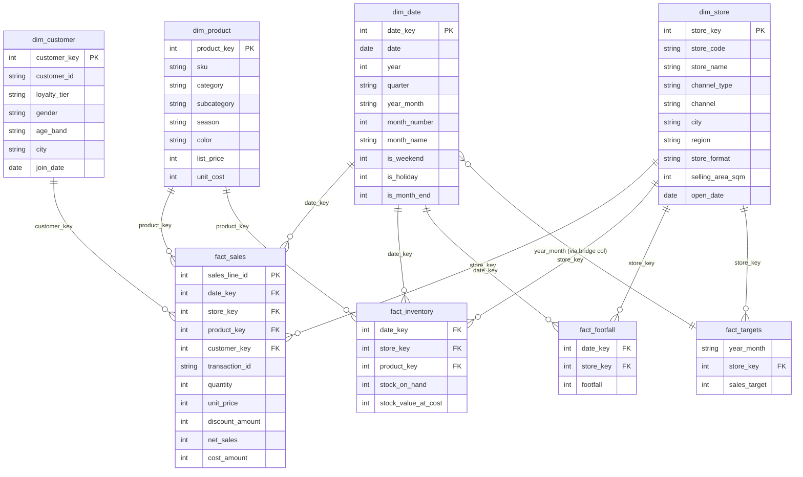

# Data model

A classic star schema: four conformed dimensions, four fact tables at different grains,
all related through integer surrogate keys. This is the shape I used for the omnichannel
retail model at a fashion chain — it keeps the DAX simple and the visuals fast.

## Grain and size

| Table | Grain | Rows | Notes |
|---|---|---|---|
| `dim_date` | one day | 731 | 2024-01-01 → 2025-12-31. **Marked as date table.** Carries Tet and public-holiday flags. |
| `dim_store` | one selling location | 15 | 12 physical stores + Website + Mobile app + Marketplace. `channel_type` ∈ {Store, Online}. Two stores opened mid-window (S08 Aug-2024, S12 Mar-2025) — used by the same-store-growth measure. |
| `dim_product` | one SKU (style × colour) | 320 | 3 categories, 14 subcategories, SS/FW season flag. |
| `dim_customer` | one loyalty member | 12,001 | Row 0 = `WALK-IN` for unidentified store transactions. |
| `fact_sales` | one transaction line | 548k | 320k transactions. `net_sales = unit_price × quantity − discount_amount`. |
| `fact_inventory` | store × SKU × **month-end snapshot** | 85k | Semi-additive: never SUM across dates. Physical stores only. |
| `fact_targets` | store × month | 339 | Monthly sales targets. Joins to `dim_date` through `year_month`. |
| `fact_footfall` | store × day | 8k | Door-counter traffic, physical stores only. Drives conversion rate. |

## Relationships

All relationships are **one-to-many, single direction**, from dimension to fact.
No bi-directional filtering anywhere — cross-filtering between facts is done in DAX
(e.g. `Conversion Rate % = Store Transactions / Footfall`), not through the model.

`fact_targets` is at month grain. Rather than a many-to-many relationship to `dim_date`,
the model uses a one-column bridge: `dim_date[year_month]` → `fact_targets[year_month]`
is implemented by relating `fact_targets` to a small `dim_month` table derived from
`dim_date` (see `power_query.pq`, query `dim_month`), and `dim_month` filters `dim_date`
one-to-many. In Power BI terms: `dim_month (1) → (*) dim_date` and `dim_month (1) → (*) fact_targets`.

## Modelling decisions and why

| Decision | Why |
|---|---|
| Integer surrogate keys everywhere (`date_key` as `yyyymmdd`) | Smallest dictionary, fastest joins in VertiPaq. Text keys on a 548k-row fact were ~3× the memory in testing. |
| `net_sales` and `cost_amount` pre-computed in the fact | Avoids `SUMX` over the fact in the hottest measures. Only `Gross Sales` (rarely used) needs an iterator. |
| Inventory kept as month-end snapshot, not daily | Daily snapshots would be 2.6M rows for a question (weeks of cover) that is asked monthly. |
| Walk-in customers as a single `customer_key = 0` member | Keeps the relationship clean (no blanks) and lets measures exclude it explicitly with `customer_key <> 0`. |
| Auto date/time **off**; one `dim_date` | Auto date/time creates a hidden date table per date column; with 4 fact tables that is wasted memory and inconsistent time intelligence. |
| Measures in a dedicated `_Measures` table with display folders | Discoverability for report authors; no measures scattered across facts. |
| No calculated columns on facts | Everything that can be computed at load time is done in Power Query (or upstream SQL); calculated columns on facts are not compressed as well and recalculate on every refresh. |

## Performance notes from the real project

The migration I led (Tableau → Power BI, retail dataset of similar shape but ~40× the rows) went
from 9–12 s to under 2 s per visual by:

1. **Collapsing a snowflake into a star** — product hierarchy was 4 tables; flattened into `dim_product`.
2. **Removing bi-directional relationships** that had been added "to make the slicers work"; replaced with `CROSSFILTER` in two measures and a bridge table.
3. **Replacing `FILTER(ALL(fact))` patterns with dimension filters** — `CALCULATE([x], dim_store[channel_type] = "Online")` instead of `CALCULATE([x], FILTER(fact_sales, RELATED(dim_store[channel_type]) = "Online"))`.
4. **Pre-aggregating the daily footfall feed** at store-day grain upstream instead of loading sensor pings.
5. **Disabling Auto date/time** (saved ~15% model size on its own).
6. **Aggregation table** for the executive page (store × month) with automatic aggregation hits for the five KPI cards.

A note on what *not* to optimise: the sales fact at 548k rows loads in ~3 s and compresses to a
few MB. The effort above is for when the fact is tens of millions of rows; a small model with a
clean star needs none of it.
